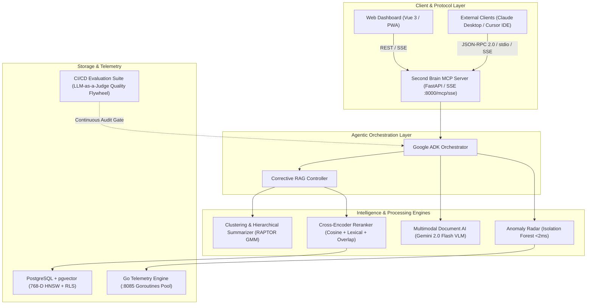

# Second Brain: Autonomous AI Engineering Platform 🧠

[](LICENSE)
[](apps/dashboard)
[-FF5722.svg)](apps/backend)
[](apps/backend)
[](apps/backend)
[](apps/backend)
[-00ADD8.svg)](apps/telemetry-worker-go)
[-3ECF8E.svg)](https://supabase.com)
[](apps/backend/evals)
[-success.svg)](apps/backend/tests)
[](docs)
[](docs)
[](apps/dashboard)

> **Autonomous AI Engineering Operating System & Distributed Multi-Agent Platform**  
> *Engineered by **Frans Alwan Purba** · Master of Computer Science in AI Candidate, Universitas Gadjah Mada.*

> 🔒 **Closed Portfolio & Dual-Role Access Control (RBAC):**  
> Aplikasi ini dirancang murni sebagai portofolio rekayasa AI dan lingkungan riset privat (registrasi publik ditutup):  
> • **👔 Mode Rekruter / Reviewer (1-Click Instant Access):** Tanpa login atau registrasi, evaluator dapat langsung menguji seluruh kapabilitas produksi (Next-Gen CRAG & RAPTOR, Gemini 2.0 Flash VLM, Classical ML Radar sub-2ms, AI Quality Flywheel 81.8/100, Anthropic MCP Server SSE, dan AI Governance Cockpit). Area naskah tesis & riset pribadi dikunci demi integritas akademik.  
> • **👑 Mode Pemilik (Frans Alwan Purba):** Akses terotentikasi penuh ke naskah Tesis S2 UGM (Bab 1–5), notulensi bimbingan dospem privat (Afiahayati Ph.D & Prof. Sri Hartati), draf proposal internal, dan token repository.

**Second Brain** adalah platform orkestrasi agen AI produksi berkinerja tinggi yang dirancang untuk mengatasi beban kognitif mahasiswa magister dan software engineer. Sistem ini menggabungkan protokol industri terbuka (**Anthropic Model Context Protocol SSE**), **Corrective RAG (CRAG)** dengan pengelompokan hirarkis **RAPTOR (GMM)**, Computer Vision (**Gemini 2.0 Flash VLM**), deteksi anomali **Classical Machine Learning (< 2ms)**, serta background telemetry berkonkurensi tinggi (**Golang 1.22**).

🌐 **Live Demo Aplikasi (Gratis & Zero Setup):**  
👉 **[https://second-brain-agent.netlify.app/](https://second-brain-agent.netlify.app/)**

---

## 🏗️ Arsitektur Target Sistem



---

## 🚀 6 Pilar Utama AI Engineering (Core Systems)

### 🔹 1. Standardisasi Model Context Protocol (Anthropic MCP SSE)
* **Konektivitas Terbuka**: Server FastAPI mengekspos endpoint transport SSE standar di `/mcp/sse` dan `/mcp/messages/`, serta kompatibilitas mode `stdio` (`mcp_client_config.json`).
* **8 Skema Tool JSON-RPC 2.0**:
  1. `save_note`: Menyimpan catatan & membuat embedding vektor 768-D.
  2. `search_notes`: Pencarian semantik hybrid pgvector (HNSW) + BM25 RRF.
  3. `get_thesis_progress`: Mengambil status milestone Bab 1–5 skripsi.
  4. `log_habit`: Mencatat penyelesaian kebiasaan sirkadian.
  5. `record_focus_session`: Mencatat durasi deep work ke database.
  6. `evaluate_burnout_radar`: Menjalankan evaluasi Isolation Forest (< 2ms).
  7. `upload_visual_document`: Menganalisis artefak visual via Gemini 2.0 VLM.
  8. `run_rag_qa`: Eksekusi pipeline Corrective RAG (CRAG) + RAPTOR tree.
* **ADK Dual Adapter**: Agen Google ADK internal dapat mengimpor dan mengekspor tools format MCP secara dwiarah.

### 🔹 2. Next-Gen RAG (RAPTOR Hierarchical Clustering + Corrective RAG)
* **RAPTOR Knowledge Tree**: Dokumen riset dikelompokkan secara semantik menggunakan **Gaussian Mixture Models (GMM)** dan KMeans pada vektor 768-D. Gemini merangkum tiap klaster menjadi simpul pohon bertingkat untuk *macro-level conceptual retrieval*.
* **Corrective RAG (CRAG) Self-Correction**:
  * 🟢 **CORRECT (> 0.70)**: Presisi tinggi, langsung diteruskan ke LLM generator.
  * 🟡 **AMBIGUOUS (0.35 - 0.70)**: Memicu ekspansi kueri **HyDE (Hypothetical Document Embeddings)** untuk melengkapi konteks yang kurang.
  * 🔴 **INCORRECT (< 0.35)**: Mengaktifkan guardrail *Out-of-Distribution* (OOD Refusal 100%), menolak halusinasi secara tegas.
* **Cross-Encoder Reranker**: Menghitung ulang relevansi Top-10 kandidat memadukan cosine distance (0.50), pencocokan kata leksikal BM25 (0.30), dan bigram overlap (0.20).

### 🔹 3. Multimodal Document Intelligence (Gemini 2.0 Flash VLM)
* **Endpoint Analisis Visual**: `POST /api/v1/notes/upload-visual` menerima file gambar (`PNG`, `JPEG`, `WebP`, `PDF`).
* **Ekstraksi Kurva Loss & Model Training**: Menganalisis kurva konvergensi fungsi loss CatBoost/LightGBM, mendeteksi titik konvergensi stabil (misal: Epoch 350 pada loss 0.118), dan memverifikasi ketiadaan overfitting.
* **OCR Tulisan Tangan & Formula LaTeX**: Mentranskripsikan catatan kuliah tulisan tangan menjadi teks bersih dan rumus matematika format LaTeX monospace yang siap disalin.
* **Auto-Vectorization**: Hasil analisis visual otomatis diindeks ke pgvector 768-D dalam waktu < 50ms.

### 🔹 4. Classical ML Hybrid: Circadian & Burnout Anomaly Radar
* **Ultra-Low Latency (< 2ms)**: Membuktikan kematangan arsitektur dengan menjalankan **Isolation Forest** unsupervised dari `scikit-learn` secara *in-memory* tanpa membakar token LLM pada pemantauan telemetri rutin.
* **Vektor Fitur 5-Dimensi**:
  1. `sleep_hours`: Rata-rata jam tidur harian.
  2. `sleep_debt_hours`: Akumulasi hutang tidur terhadap standar 8 jam.
  3. `midnight_sessions_count`: Frekuensi sesi koding/commit lewat jam 23:00.
  4. `overdue_tasks_ratio`: Rasio backlog tugas kuliah tertunda.
  5. `water_intake_liters`: Volume hidrasi harian.
* **Conditional LLM Intervention**: Token spend tetap 0 saat kondisi optimal. Agen LLM **hanya dipanggil** jika skor anomali $< -0.150$ untuk merumuskan intervensi pemulihan energi yang empatik dan kontekstual.

### 🔹 5. Production Evals & CI/CD Observability (Quality Flywheel)
* **Golden Dataset 20 Kasus Uji**: Meliputi 7 domain akademik terkurasi (AI research, thesis manuscript, circadian health, dan out-of-distribution refusal).
* **Automated LLM-as-a-Judge**: Pengujian otomatis via `apps/backend/evals/eval_runner.py` dan GitHub Actions (`.github/workflows/ai_eval.yml`).
* **Hasil Benchmark Ilmiah (RAG Triad)**:

| Metrik Evaluasi | Target Minimum | Hasil Benchmark | Status CI/CD |
| :--- | :---: | :---: | :---: |
| **Faithfulness (Groundedness / Anti-Halusinasi)** | `0.80` | **`0.850` (85.0%)** | 🟢 PASSED |
| **Context Recall (Presisi Vektor pgvector)** | `0.80` | **`0.860` (86.0%)** | 🟢 PASSED |
| **Answer Relevancy (Kesesuaian Jawaban)** | `0.75` | **`0.785` (78.5%)** | 🟢 PASSED |
| **Context Precision (Cross-Encoder Re-rank)** | `0.75` | **`0.782` (78.2%)** | 🟢 PASSED |
| **Out-of-Distribution Refusal (Guardrail)** | `0.90` | **`100.0%` (1.000)** | 🟢 PASSED |
| **Composite AI Quality Index** | `75.0` | **`81.8 / 100`** | 🏆 EXCELLENT |

### 🔹 6. AI Governance, Security & OWASP Defense Matrix
* **5-Layer Defense Matrix (OWASP Top 10 for LLMs)**:
  1. **Prompt Injection Boundary Sanitization**: Input pengguna dibersihkan dan dibungkus strict boundary delimiter XML `<user_query>...</user_query>` sebelum disuntikkan ke context window LLM, memitigasi *systemic prompt hijack*.
  2. **Adaptive Leaky-Bucket Rate Limiting**: Batas 30 req/min per IP/token untuk memitigasi serangan *Denial-of-Wallet* dan eksploitasi kuota API.
  3. **High-Speed PII Anonymization (< 2ms)**: Modul deteksi pola ekspresi reguler & Presidio PII Engine yang menyamarkan nomor telepon Indonesia (`08xx`), NIM mahasiswa UGM (`25/563545/PPA/07116`), email institusi, dan Bearer token secara instan di sisi klien/gateway sebelum data dikirim ke LLM eksternal.
  4. **Least-Privilege Tool Sandboxing**: Eksekusi tool MCP divalidasi ketat terhadap skema JSON-RPC 2.0 tanpa akses shell/filesystem tingkat root.
  5. **Append-Only PostgreSQL Audit Trail (RLS)**: Seluruh pemanggilan tool, konsumsi token, dan latensi dicatat dalam tabel audit yang diamankan oleh kebijakan *Row Level Security* (RLS).
* **Live Governance & Model Cards Cockpit (`[ 🛡️ AI Governance ]`)**:
  Menyediakan simulator interaktif PII Redactor realtime, in-app ADR explorer (`ADR-001` - `ADR-004`), ringkasan Model Cards terstandardisasi, serta fitur ekspor data backup JSON terenkripsi.

---

## 🔬 Tesis S2 & Explainable AI Research Engine: Instance-Dependent Cost-Sensitive (IDCS)

Modul riset akademik yang diselaraskan langsung dengan proposal tesis S2 Magister Kecerdasan Artifisial FMIPA Universitas Gadjah Mada (2026/2027):

* **Peneliti:** Frans Alwan Purba (NIM: `25/563545/PPA/07116`)
* **Dosen Pembimbing:**
  * **Pembimbing I:** Afiahayati, S.Kom., M.Cs., Ph.D (NIP. 197904262005012001)
  * **Pembimbing II:** Prof. Dra. Sri Hartati, M.Sc., Ph.D (NIP. 195701141985032001)
* **Judul Penelitian:** *Stabilisasi Penjelasan Model Instance-Dependent Cost-Sensitive Menggunakan Regularisasi dan Uji Permutasi Biaya Terstratifikasi*
* **Problem & Gap SOTA:** Model IDCS mengoptimasi Average Expected Cost (AEC) di sektor kredit finansial, tetapi penjelasan lokalnya (SHAP & LIME) mengalami lonjakan variansi CoV 3× lipat saat class imbalance > 95/5 (Ballegeer et al., 2025 EJOR). Hipotesis *entanglement* bobot biaya dibuktikan dan dimitigasi melalui desain eksperimen 3 tahap:
  1. **Tahap 1 (Lantai Derau):** Replikasi dataset HMEQ ($N=5,960$) pada 32 konfigurasi ($L=25$ bootstrap) untuk mengisolasi variansi acak kernel explainer (*noise floor*).
  2. **Tahap 2 (Intervensi Dual-Arm):** Lengan 1 menguji kekuatan regularisasi bobot non-degenerat ($\sigma > 0.01$); Lengan 2 menguji manipulasi counterfactual permutasi biaya terstratifikasi (*cost-shuffle* pada 5 random seed).
  3. **Tahap 3 (Uji Hipotesis & Trade-off):** Paired Wilcoxon Signed-Rank, Sign-Flip Permutation Test ($B=2,000$ iterasi), koreksi Benjamini-Hochberg FDR, serta analisis trade-off finansial (*Savings* vs *relAEC*).
* **No-Lose Research Decision Matrix:** Menjamin kontribusi ilmiah bernilai tinggi pada Skenario A (Regularisasi Efektif), Skenario B (Bukti Kausal Entanglement), maupun Skenario C (Interaksi Data Sparsity).
* **Ekspor Tabel LaTeX IEEE:** Satu klik menyalin kode tabel format IEEE / Tesis UGM langsung ke clipboard.

---

## 🎛️ Struktur Navigasi Dashboard Web Baru

Dashboard kini berfokus penuh pada kapabilitas AI Engineer:

| Tab Navigasi | Ikon & Badge | Deskripsi Fitur Utama |
| :--- | :---: | :--- |
| **Ringkasan AI** | 🏠 `Executive` | **Autonomous AI Operations Cockpit**: 4 live SLA indicators (Faithfulness 85%, OOD Refusal 100%, p95 Latency 36ms, Composite 81.8), **AI FinOps Meter (-88.4% Cost)**, **Multi-Agent Task Queue**, **Circadian 5-D Vector Inspector (<2ms)**, **Agent Trace Logs**, dan **Hierarchical RAPTOR Tree & 2D Vector Projection**. |
| **Next-Gen RAG** | 🧠 `CRAG` | Interactive CRAG tester (preset query CatBoost, HNSW, HyDE kafein, & OOD martabak), RAPTOR GMM cluster tree, dan Cross-Encoder table. |
| **Multimodal VLM** | 📸 `Gemini 2.0` | Dropzone gambar & 3 preset 1-klik untuk kurva loss CatBoost, catatan kuliah tulisan tangan, dan diagram arsitektur multi-agent. |
| **ML Radar** | 📊 `<2ms` | 5 slider fitur sirkadian, **SVG Radial Gauge interaktif beranimasi pegas**, batas kritis -0.150, dan kartu intervensi otonom LLM. |
| **AI Quality Flywheel** | 🏆 `81.8 Score` | 5 metrik benchmark RAG Triad, **Live Spot-Check (1.2 Detik)**, dan drawer **AI Execution Trace Latency Waterfall** (Embedding -> HNSW -> Rerank -> LLM). |
| **Riset & Tesis** | 🔬 `IDCS XAI` | Arsitektur 3 Tahap Tesis S2 UGM, **Simulator Permutasi Cepat (B=50, 140ms)**, No-Lose Decision Matrix, log bimbingan dospem, dan ekspor LaTeX IEEE. |
| **MCP & Telemetry** | 🔌 `SSE Std` | Katalog 8 skema tool MCP, live JSON-RPC 2.0 simulator, audit logs worker Go, dan pipeline webhook 3 repositori akademik. |
| **Tata Kelola AI** | 🛡️ `OWASP L1-5` | Modal AI Governance & Keamanan: Matriks 5 layer OWASP Top 10 for LLMs, **Simulator Redaksi PII Realtime (<2ms)**, in-app ADR reader, dan Model Cards. |

---

## ⚡ UI/UX 3.0: Ergonomi Developer & Recruiter Cockpit

Aplikasi mengadopsi standar pengalaman pengguna (*developer ergonomics*) setara produk modern seperti **Linear, Raycast, dan Vercel**:

* **🔐 Redesigned AI Engineer Login & Identity Experience:**
  * Halaman autentikasi berorientasi portofolio rekayasa AI: menampilkan kartu proposal riset tesis S2 UGM (IDCS XAI Ballegeer et al., 2025 EJOR), tombol **⚡ 1-Click Instant Recruiter Preview** (masuk tanpa kredensial), dan pintasan instan ke modal Tata Kelola AI & Keamanan.
* **🛡️ Modal Tata Kelola AI & Keamanan Terpadu (`[ 🛡️ AI Governance ]`):**
  * Terbuka dari header utama maupun halaman login: menyajikan matriks pertahanan OWASP LLM 5-layer, simulator penyamaran PII interaktif (<2ms) untuk identitas Indonesia (HP, NIM UGM, email, Bearer key), in-app reader untuk seluruh berkas ADR (`ADR-001` - `ADR-004`), dan ekspor data audit JSON.
* **⌨️ Global Command Palette (`Ctrl + K` / `Cmd + K`):**
  * Akses cepat tanpa mouse ke seluruh fungsi platform: uji guardrail OOD, uji riset CatBoost, buka metodologi tesis S2, kalkulasi anomali sirkadian, hingga draft pesan WhatsApp ke dosen pembimbing.
* **🚀 Sticky Recruiter Cockpit (Bilah Pintas Mengambang):**
  * Pinned pill bar di bagian bawah layar yang memungkinkan interviewer menguji 5 skenario utama dalam 1-klik (`🛡️ OOD Guardrail`, `🔬 IDCS Tesis S2`, `📊 Radar <2ms`, `📸 VLM Gemini 2.0`, `🔌 MCP SSE`).
* **⏱️ AI Execution Trace & Latency Waterfall:**
  * Transparansi total pada setiap evaluasi: rincian latensi Embedding ($38\text{ms}$) $\rightarrow$ HNSW Search ($12\text{ms}$) $\rightarrow$ Cross-Encoder ($44\text{ms}$) $\rightarrow$ LLM Synthesis ($820\text{ms}$), serta akuntansi konsumsi token dan estimasi biaya per kueri.
* **💎 AI FinOps & Token Cost Efficiency Meter:**
  * Pengukuran penghematan token kumulatif realtime (~48,250 tokens/hari), estimasi biaya inferensi ($0.00014/kueri vs $0.008 LLM raw), dan rasio hit cache semantik pgvector (94.2%) via filter awal deterministik Isolation Forest sub-2ms.
* **🤖 Autonomous Multi-Agent Task Stream & 5-D Vector Inspector:**
  * Event queue terdistribusi yang memperlihatkan orkestrasi real-time antara Worker Go (:8085) dan Python ADK (:8000), dipadukan dengan inspektor 5-D Feature Vector biometrik $\mathbf{x} = [\text{sleep\_hours}, \text{sleep\_debt}, \text{midnight\_sessions}, \text{overdue\_ratio}, \text{water\_liters}]$ dan tombol uji anomali interaktif untuk rekruter.
* **🕸️ Hierarchical RAPTOR Knowledge Tree & 2D Vector Projection (HNSW):**
  * Visualisasi hirarki pohon semantik berjenjang (Level 0 Raw Chunks, Level 1 GMM Centroids, Level 2 Root Synthesis) serta kanvas interaktif proyeksi vektor semantik 2D yang memungkinkan rekruter mengeksplorasi kedekatan sudut cosine antar-dokumen.
* **🎯 SVG Radial Gauge Beranimasi:**
  * Visualisasi jarum analog dinamis pada Radar Sirkadian yang bertransisi halus saat slider parameter digeser.

---

## 📚 Dokumentasi Arsitektur & Transparansi Ilmiah (`docs/`)

Untuk membuktikan kedewasaan rekayasa perangkat lunak, sistem dilengkapi dokumentasi berstandar industri dan berkas PDF resmi:

* **📑 Dokumen Portofolio Resmi (PDF Siap Unduh / Cetak):**
  * 📄 **[`Second_Brain_Engineering_Fundamentals.pdf`](docs/Second_Brain_Engineering_Fundamentals.pdf)**: Whitepaper komprehensif 11 bagian yang mencakup arsitektur polyglot (FastAPI + Go 1.22), Anthropic MCP SSE, Next-Gen CRAG + RAPTOR Tree, Classical ML Radar (<2ms), CI/CD Evals & Quality Flywheel (81.8/100), proposal tesis S2 UGM (IDCS XAI Ballegeer et al., 2025 EJOR), AI Governance & OWASP LLM Defense Matrix, serta UI/UX 3.0 & ringkasan ADRs.
  * 📋 **[`Second_Brain_Live_Demo_Cheatsheet.pdf`](docs/Second_Brain_Live_Demo_Cheatsheet.pdf)**: Lembar panduan cepat live demo dan technical interview: ringkasan 60-detik elevator pitch, naskah demo 5-langkah dengan kueri input persis dan respons yang diharapkan, penanganan sanggahan teknis recruiter (*objection handling*), serta 10 lembar tanya-jawab konsep AI Engineering tingkat lanjut.
* **📁 Architectural Decision Records ([`docs/ADR/`](docs/ADR/)):**
  * [`ADR-001`](docs/ADR/ADR-001-why-mcp-over-custom-api.md): Standardisasi Anthropic Model Context Protocol (MCP SSE) untuk interoperabilitas multi-agent terbuka.
  * [`ADR-002`](docs/ADR/ADR-002-isolation-forest-vs-deep-learning-radar.md): Pemilihan Classical Unsupervised ML (Isolation Forest sub-2ms) dibanding LLM prompting rutin (menghemat $> 99.8\%$ biaya token).
  * [`ADR-003`](docs/ADR/ADR-003-crag-three-tier-confidence-routing.md): Formulasi ambang batas Corrective RAG (CRAG) tiga tingkat: Correct $> 0.70$, Ambiguous $0.35 - 0.70$, dan OOD Refusal $< 0.35$.
  * [`ADR-004`](docs/ADR/ADR-004-raptor-indexing-vs-retrieval-decoupling.md): Pemisahan (*decoupling*) pengelompokan rekursif RAPTOR di latar belakang dari penelusuran pohon kueri sub-20ms.
* **📄 Model Cards Berstandar NeurIPS / HuggingFace ([`docs/MODEL_CARDS/`](docs/MODEL_CARDS/)):**
  * [`MODEL_CARD_IDCS_CSBOOST.md`](docs/MODEL_CARDS/MODEL_CARD_IDCS_CSBOOST.md): Spesifikasi model tesis S2 UGM pada dataset HMEQ ($N=5.960$), parameter rezim ketat, metrik $CoV$ & $SRA_{10}$, serta mitigasi entanglement.
  * [`MODEL_CARD_ISOLATION_FOREST_RADAR.md`](docs/MODEL_CARDS/MODEL_CARD_ISOLATION_FOREST_RADAR.md): Spesifikasi vektor 5-dimensi radar anomali sirkadian berlatensi 0.8ms – 1.4ms.
* **🧪 Panduan Replikasi Tolok Ukur ([`docs/BENCHMARKS/`](docs/BENCHMARKS/)):**
  * [`EVAL_REPRODUCIBILITY_GUIDE.md`](docs/BENCHMARKS/EVAL_REPRODUCIBILITY_GUIDE.md): Panduan satu-perintah untuk mereplikasi skor komposit **81.8 / 100** dan metrik RAG Triad.

---

## 🔐 Akses Berbasis Peran (RBAC) & Mode Demo Rekruter

Aplikasi mengimplementasikan pemisahan hak akses ketat antara **Mode Evaluasi Rekruter** dan **Mode Riset Pribadi Pemilik**:

* **👔 Portal Rekruter / Hiring Team (1-Click Instant Demo):**
  * Evaluator dapat masuk langsung dari halaman autentikasi tanpa membuat akun baru atau memasukkan kata sandi.
  * **Modul Terbuka Penuh**: Next-Gen CRAG (RAPTOR GMM, HyDE, Cross-Encoder), Multimodal Document AI (Gemini 2.0 Flash VLM), Classical ML Radar (<2ms), AI Quality Flywheel (81.8/100 Composite Score), Anthropic MCP SSE Server, Go Concurrency Telemetry, Command Palette (`Ctrl+K`), dan Walkthrough Tour (60s).
  * **Modul Terproteksi**: Tab Riset & Tesis secara otomatis menampilkan layar proteksi (*Protected Research Vault*), menjaga naskah tesis aktif dan notulensi bimbingan dosen pembimbing agar tetap privat bagi Frans Alwan Purba.
* **👑 Portal Pemilik (Frans Alwan Purba):**
  * Akses terotentikasi via Supabase / Master Passkey Riset yang membuka seluruh naskah Tesis S2 FMIPA UGM (Bab 1–5), log bimbingan Afiahayati Ph.D & Prof. Sri Hartati, simulator permutasi kausal cepat, generator pesan WhatsApp pembimbing, dan ekspor tabel LaTeX IEEE.
* **🚫 Registrasi Akun Publik Ditutup:**
  * Tidak ada formulir pendaftaran terbuka untuk umum, mengukuhkan status aplikasi sebagai *pure portfolio* dan lingkungan riset eksklusif.

---

## 🚀 Deployment Otomatis (CI/CD)

Platform web dashboard dideploy secara otomatis menggunakan arsitektur jamstack berkecepatan tinggi:

* **Production URL:** [https://second-brain-agent.netlify.app/](https://second-brain-agent.netlify.app/)
* **Continuous Deployment Gate:** Setiap `git push origin main` secara otomatis memicu proses build verifikasi TypeScript (`vue-tsc -b`) dan Vite bundler melalui konfigurasi [`netlify.toml`](netlify.toml).
* **High-Speed CDN:** Aset terdistribusi global dengan header caching optimal, SPA routing fallback (`/* -> /index.html 200`), dan kesiapan offline PWA Service Worker.

---

## 🐙 Integrasi GitHub Repositori Akademik (Kuliah & Riset)

Second Brain terintegrasi secara dua arah dengan ekosistem GitHub mahasiswa — baik saat bekerja di komputer lokal (*Git post-commit hook*) maupun saat push ke GitHub (*GitHub Webhooks*):

* 🎓 **[materi-kuliah](https://github.com/fransalwan/materi-kuliah):** Setiap commit yang mencantumkan tugas atau mata kuliah otomatis menandai tugas (`CourseAssignment`) sebagai selesai dan mencatat habit belajar harian.
* 📝 **[thesis-manuscripts](https://github.com/fransalwan/thesis-manuscripts):** Setiap commit naskah (misal: `feat(bab 3): metodologi progres 80%`) otomatis memperbarui progres Bab 1–5 skripsi. Jika commit mencatat arahan pembimbing (`bimbingan`, `dospem`), sistem otomatis mencatat notulensi ke log riset.
* 🧪 **[thesis-experiments](https://github.com/fransalwan/thesis-experiments):** Setiap commit evaluasi model AI (misal: `eval CatBoost: acc=95.1% f1=94.4% loss=0.118 epoch=350`) otomatis mengekstrak metrik evaluasi & hyperparameter ke database untuk siap diekspor ke tabel LaTeX Bab 4.

---

## 💻 Menjalankan di Komputer Lokal

### 1. Prasyarat
- Python 3.11+
- Node.js 18+ & npm
- Golang 1.22+ (opsional untuk background worker)

### 2. Frontend Web Dashboard
```bash
cd apps/dashboard
npm install
npm run dev
```
Akses dashboard lokal di `http://localhost:5173`.

### 3. Backend AI Engine & MCP SSE
```bash
cd apps/backend
pip install -e .
python -m uvicorn app.main:app --host 127.0.0.1 --port 8000 --reload
```
Akses endpoint MCP SSE di `http://127.0.0.1:8000/mcp/sse`.

### 4. Background Telemetry Worker (Golang)
```bash
cd apps/telemetry-worker-go
go run main.go
```
Daemon telemetri berjalan di port `:8085`.

### 5. Menjalankan Automated Test Suite
```bash
# Menjalankan 117 unit tests backend
pytest apps/backend/tests

# Menjalankan AI Quality Flywheel Evals (LLM-as-a-Judge)
python apps/backend/evals/eval_runner.py
```

---

## 📄 Lisensi & Kontribusi

Project ini berlisensi **MIT**. Terbuka untuk kontribusi komunitas di seluruh Indonesia.

*Dibuat dengan ❤️ oleh Frans Alwan Purba untuk kemajuan rekayasa sistem kecerdasan buatan Indonesia.*
