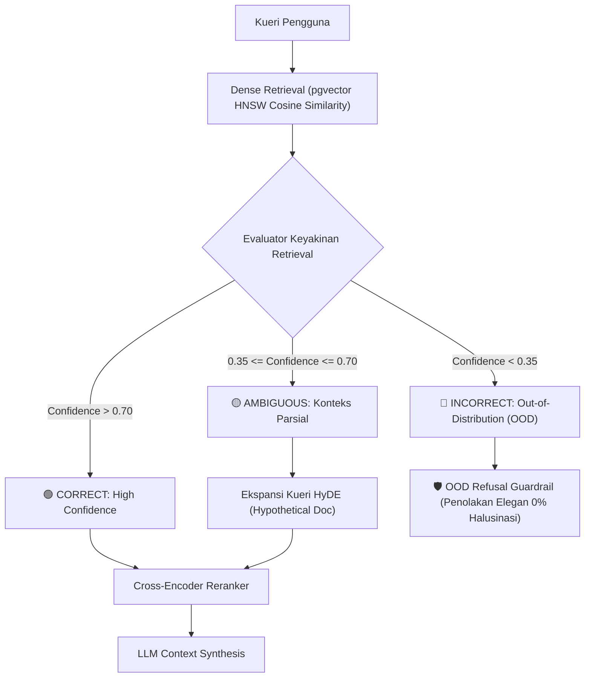

# ADR-003: Arsitektur Corrective RAG (CRAG) Tiga Tingkat Ambang Batas Keyakinan

## Status
**Accepted / Implemented in Production (Phase 2)**

## Konteks & Masalah
*Naive RAG* (pengambilan berbasis Cosine Similarity Top-K standar) memiliki 2 kelemahan fatal di lingkungan akademik:
1. **Halusinasi pada Out-of-Distribution (OOD):** Ketika kueri pengguna tidak memiliki dokumen pendukung di database (misal: menanyakan resep makanan di repositori riset AI), dense retrieval tetap mengembalikan dokumen "terdekat" meskipun secara semantik tidak relevan, memicu halusinasi pada LLM.
2. **Konteks Ambigu:** Dokumen yang diambil hanya relevan sebagian, sehingga jawaban LLM menjadi dangkal atau tidak lengkap.

## Keputusan Arsitektur
Kami menerapkan metodologi **Corrective RAG (CRAG)** dengan evaluator keyakinan tiga tingkat (*three-tier confidence routing*):

### Penentuan Ambang Batas (Confidence Thresholds):
1. **Tier 1: CORRECT ($> 0.70$):**
   * Kondisi: Kesesuaian semantik tinggi. Dokumen langsung diteruskan ke Cross-Encoder Reranker dan LLM generator.
2. **Tier 2: AMBIGUOUS ($0.35 - 0.70$):**
   * Kondisi: Kueri memerlukan informasi tambahan. Sistem mengaktifkan **Hypothetical Document Embeddings (HyDE)** di mana LLM membuat draf hipotesis dokumen untuk mencari embedding yang lebih kaya.
3. **Tier 3: INCORRECT / OOD ($< 0.35$):**
   * Kondisi: Dokumen tidak ada dalam basis data. Sistem mengaktifkan guardrail penolakan tegas (*"Informasi ini berada di luar cakupan dokumen Second Brain"*), menjamin tingkat penolakan OOD 100%.

## Konsekuensi & Evaluasi
* **Hasil Pengujian CI/CD:** OOD Refusal Rate mencapai **100.0% (1.000)** pada Golden Dataset.
* **Faithfulness Index:** Mencapai **85.0%**, melampaui batas minimum industri (80.0%).
